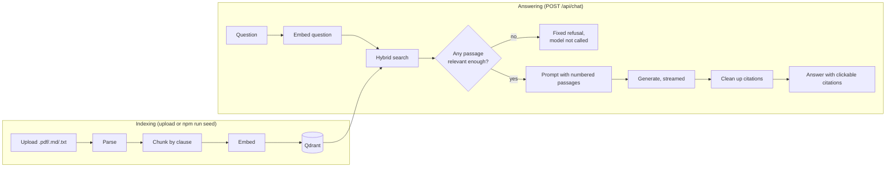

# Architecture walkthrough: from upload to cited answer

This document follows one contract through Lexica, from the moment it is uploaded to the moment an answer cites it. At each stage it points at the module that does the work, explains the idea in plain language and names the tradeoff that was made. The second half collects the design tradeoffs in one place, and the end lists what a production version would add.

If you have never built RAG before, read it top to bottom once with the code open next to it. Every file path is relative to the repo root.

## Contents

- [RAG in one paragraph](#rag-in-one-paragraph)
- [The big picture](#the-big-picture)
- [Part 1: indexing a document](#part-1-indexing-a-document) (upload, parse, chunk, embed, store)
- [Part 2: answering a question](#part-2-answering-a-question) (retrieve, decide, prompt, generate, cite)
- [Part 3: design tradeoffs](#part-3-design-tradeoffs)
- [Part 4: what a production version would add](#part-4-what-a-production-version-would-add)
- [Interview cheat sheet](#interview-cheat-sheet)

## RAG in one paragraph

A language model only knows what it saw in training, and it will happily invent an answer when it does not know. **Retrieval-Augmented Generation (RAG)** fixes that by doing a search first: find the few passages in _your_ documents that are most likely to contain the answer, paste them into the prompt, and tell the model to answer only from those passages and say which one it used. The model becomes a reader and summariser of evidence you handed it, not an oracle. For legal work this is the whole point: an answer is only useful if a lawyer can check it against the source wording.

RAG has two halves that run at different times:

1. **Indexing** (once per document): cut the document into passages, turn each passage into a vector (a list of numbers that captures its meaning) and store it in a vector database.
2. **Answering** (once per question): turn the question into a vector the same way, find the stored passages with the closest vectors, and give those passages to the chat model.

## The big picture



Where things run:

| Piece                          | Technology                                                                        | Where                                   |
| ------------------------------ | --------------------------------------------------------------------------------- | --------------------------------------- |
| Web app                        | Vite + React + TypeScript, Tailwind + shadcn/ui, TanStack Query, AI SDK `useChat` | `packages/web`, on the host (port 5173) |
| API and the whole RAG pipeline | Hono on Node, TypeScript                                                          | `packages/api`, on the host (port 8787) |
| Request/response shapes        | Zod schemas shared by both sides                                                  | `packages/shared`                       |
| Vector database                | Qdrant                                                                            | Docker (port 6333)                      |
| Embedding and chat models      | Ollama with `nomic-embed-text` and `qwen2.5:3b`                                   | Docker (port 11434), CPU only           |

The web app never talks to Qdrant or Ollama. The Vite dev server proxies `/api` to the API (`packages/web/vite.config.ts`), and the API owns every RAG step.

### The provider seam

The pipeline never calls Ollama or Qdrant directly. It talks to three small interfaces in `packages/api/src/providers/types.ts`:

- **`Embedder`**: `embedDocuments(texts)` and `embedQuery(text)` turn text into vectors of a fixed size.
- **`ChatModel`**: `stream({ system, messages, signal })` returns the answer as a stream of text pieces.
- **`VectorStore`**: `upsert`, `search`, `deleteDocument`, `listDocuments`, plus `init`, `checkHealth` and `drop` (the eval deletes its temporary collection with it).

`packages/api/src/app.ts` is an app factory: `createApp(providers, { minRelevanceScore })` receives its providers instead of creating them. Production wiring (`packages/api/src/bootstrap.ts`, shared by the server, `npm run seed` and `npm run eval`, with `providers/index.ts`) passes the real Ollama and Qdrant implementations (`providers/ollama.ts`, `providers/qdrant.ts`); the tests pass in-memory fakes (`packages/api/test/fakes.ts`). This one design choice gives you two things to talk about: tests that run in a second without Docker, and a single place to swap local models for cloud models (see [Local vs cloud models](#local-vs-cloud-models)).

## Part 1: indexing a document

We follow `samples/mutual-nda-quillmere-tessellate.md`, a fictional mutual NDA, and in particular its clause 5.3:

> 5.3 **Survival of confidentiality.** The obligations in Articles 2, 3 and 4 survive the expiry or termination of this Agreement for a period of five (5) years after the date of expiry or termination. [...]

The whole indexing pipeline is one function, `indexDocument` in `packages/api/src/pipeline/indexer.ts`. Both the upload endpoint and `npm run seed` call it, so the sample contracts and your own files go through exactly the same steps.

### Stage 0: upload

**Module:** `packages/api/src/routes/documents.ts` (`POST /api/documents`), and in the browser `packages/web/src/features/documents/upload-document.tsx` with `apiUpload` in `packages/web/src/lib/api-client.ts`.

The browser sends the file as `multipart/form-data` in a field called `file`. The web app checks the extension and the 20 MB limit first for instant feedback, and shows real upload progress (it uses `XMLHttpRequest` because `fetch` cannot report upload progress). The API checks everything again, because the client can never be trusted:

- larger than 20 MB (`MAX_UPLOAD_BYTES` in `packages/shared/src/documents.ts`): `413 FILE_TOO_LARGE`;
- not multipart or no file: `400 VALIDATION_ERROR`;
- extension other than `.pdf`, `.md` or `.txt`, in any case: `415 UNSUPPORTED_FILE_TYPE` (the type is decided by extension, because browsers often send an empty MIME type for `.md`; `fileTypeFromName` in `packages/shared/src/documents.ts`, also used by the seed command);
- empty, damaged or text-less file: `422` with `EMPTY_DOCUMENT` or `UNPARSEABLE_FILE` (thrown as `DocumentRejectedError`, `pipeline/errors.ts`);
- Ollama or Qdrant down while indexing: `503` with `EMBEDDER_UNAVAILABLE` or `VECTOR_STORE_UNAVAILABLE` and a message saying which service to start (thrown as `ProviderUnavailableError`, `pipeline/errors.ts`), like list, delete and chat already did.

Every error uses the same JSON shape, `{ "error": { "code", "message" } }`, with the codes listed in one enum (`apiErrorCodeSchema` in `packages/shared/src/error.ts`) and sent by one helper (`packages/api/src/routes/errors.ts`), so the UI can show the message as-is.

On the seed path, `packages/api/src/cli/seed.ts` reads every `.md`, `.txt` and `.pdf` in `samples/` (`pipeline/seed.ts`) and hands it to the same `indexDocument`.

Indexing happens inside the upload request: the response only comes back when the document is searchable. That is simple and fine for contracts of a few dozen pages; a production system would use a background job queue (see Part 4).

### Stage 1: parse

**Module:** `packages/api/src/pipeline/parser.ts`

Parsing turns bytes into plain text. The output is a list of pages, `{ page, text }[]`, so a page number found here can travel all the way to the citation.

- **Markdown and plain text** have no pages. They become one "page" with `page: null`. Windows line endings are normalised to `\n` so the chunker only deals with one kind.
- **PDF** is parsed page by page with `unpdf` (a serverless build of Mozilla's PDF.js). PDFs over 500 pages are refused, because extraction runs on the API's event loop.
- A PDF with no extractable text is rejected with a message that says scanned PDFs need OCR, which Lexica does not do.

Our NDA is Markdown, so it becomes a single page with `page: null`.

**Tradeoff:** PDF text extraction is lossy. Tables, two-column layouts, headers and footers can come out in a strange order, and scanned PDFs contain only images. Lexica keeps it simple and says so clearly when there is no text, instead of indexing an empty document.

### Stage 2: chunk

**Module:** `packages/api/src/pipeline/chunker.ts` (`chunkDocument`)

Search works on passages, not whole documents: a 20-page contract as one vector would be a blurry average of everything in it. So each document is cut into **chunks**. How you cut matters more than almost anything else in RAG, and legal text gives us a gift: it already says where its natural boundaries are.

The chunker works in two passes.

**Pass 1, structure first.** It reads the text line by line:

- an article heading (`## Article 5 — Term and Termination`, `ARTICLE VII: ...`, `Section 3. Fees`) starts a new article;
- a numbered clause (`5.3 ...`) starts a new section; inside Article 5 only `5.x` counts, so a line starting with "2.5 million" in prose is not mistaken for a clause;
- any other Markdown heading starts a section of its own; text before the first heading becomes the "Preamble".

Each section gets a human-readable label built from the article prefix, the clause number and the clause's bold title. Clause 5.3 becomes:

```
section: "Art. 5.3 — Survival of confidentiality"
context: ["Art. 5 — Term and Termination"]
page:    null
text:    "5.3 **Survival of confidentiality.** The obligations in Articles 2, 3 and 4 survive ..."
```

An article heading with no text of its own (all its text is in its clauses) produces no chunk.

**Pass 2, size second.** A section longer than 1,200 characters (`DEFAULT_CHUNKER_OPTIONS`: `maxChars: 1200`, `overlapChars: 150`) is split at sentence boundaries into pieces that repeat the last ~150 characters of the previous piece. A sentence cut at a boundary then still appears whole in one of the pieces. Every piece keeps the label of the clause it came from, so it still cites correctly. The limit sits well below what `nomic-embed-text` can read (about 2,000 tokens), so nothing is silently cut off by the model.

The three sample contracts have short clauses, so in practice one clause is one chunk.

**Tradeoff:** see [Chunking legal text by clause](#chunking-legal-text-by-clause).

### Stage 3: embed

**Modules:** `packages/api/src/pipeline/indexer.ts` (`embeddingText`, the batching loop) and `packages/api/src/providers/ollama.ts` (`createOllamaEmbedder`)

An **embedding** is a vector (here 768 numbers) that a model computes from a piece of text, trained so that texts with similar meaning get vectors that point in similar directions. "How long does confidentiality last after termination?" and "The obligations ... survive the expiry or termination ... for a period of five (5) years" share few words but land close together. That closeness is measured with **cosine similarity**: 1 means the same direction, 0 means unrelated.

Two details make Lexica's embeddings better than the naive version:

1. **What gets embedded is not just the clause.** `embeddingText` prepends the document name and the headings:

   ```
   mutual-nda-quillmere-tessellate.md
   Art. 5 — Term and Termination
   Art. 5.3 — Survival of confidentiality

   5.3 **Survival of confidentiality.** The obligations in Articles 2, 3 and 4 survive ...
   ```

   A clause like "Either party may terminate on 30 days' notice" says nothing about which contract it belongs to. With the headings in front, a question such as "notice period in the NDA" can match it.

   The keyword index (stage 4) gets the same text **without** the document name (`keywordText`). In the keyword index the name would be a word in every chunk of the document, so any question naming the document ("What does the NDA say about force majeure?") would match all of its chunks equally and look like keyword evidence for every one of them.

2. **Task prefixes.** `nomic-embed-text` was trained with prefixes: stored passages are embedded as `search_document: ...` and questions as `search_query: ...`. Using the matching prefixes puts a question close to the passages that answer it, rather than close to other questions.

Chunks are sent to Ollama's `/api/embed` in batches of 32 (`EMBED_BATCH_SIZE`), and the embedder checks that it got one vector of the configured size (`EMBEDDING_DIMENSIONS`, default 768) per text.

**Tradeoff:** see [Embedding model choice](#embedding-model-choice).

### Stage 4: store

**Modules:** `packages/api/src/pipeline/indexer.ts` (step 4) and `packages/api/src/providers/qdrant.ts` (`upsert`, `prepareCollection`)

Each chunk becomes one **point** in a single Qdrant collection (`QDRANT_COLLECTION`, default `lexica_chunks`). A point holds:

- two vectors:
  - `dense`: the 768-number embedding, compared by cosine distance (semantic search);
  - `bm25`: a sparse keyword vector that Qdrant computes itself from the keyword text (headings plus passage), with IDF weighting (keyword search, see [Hybrid search](#hybrid-search));
- a **payload** with everything a citation needs: `documentId`, `documentName`, `fileType`, `section`, `page`, `chunkIndex`, `text`, `createdAt` (`ChunkPayload` in `providers/types.ts`).

Some decisions worth knowing:

- **Document identity is the file name.** `documentIdFor(name)` hashes the name into a UUID-shaped id. Uploading a file with the same name again produces the same id, so re-uploading replaces, never duplicates. The order matters: the indexer gives every new chunk its own id, **upserts the new chunks first**, and only then deletes the document's other chunks (`deleteDocument(id, { keep: newIds })`). If writing the new version fails (Qdrant goes down mid-upload), the upload returns 503 and the earlier version is still there. It is not a transaction: for a moment both versions are searchable, and if only the delete fails, both stay until the next upload of that file.
- **`documentId` has a payload index**, so "delete every chunk of this document" (and, in a future version, "search only these documents") stays fast.
- **There is no database besides Qdrant.** The Documents page list (`GET /api/documents`) is derived from the chunks: `listDocuments` scrolls through all payloads and `summarizeDocuments` (`providers/summarize.ts`) groups them by document and counts chunks. Deleting a document (`DELETE /api/documents/:id`) deletes its chunks, so it can never show up in an answer again.
- **The collection is created on API startup** if missing (`packages/api/src/index.ts` calls `vectorStore.init()`). If Qdrant is not up yet, the API still starts and the health indicator shows the problem. A collection in an older layout (from before hybrid search, or with a different vector size) is refused with a message to run `npm run seed`, which recreates it. That is destructive: recreating the collection deletes every document in it, uploads included, so the seed command prints a prominent warning when it happens and only the sample contracts come back.

The NDA is now 26 searchable points (the preamble plus its clauses). It is ready to be asked about.

## Part 2: answering a question

The question: **"How long do the confidentiality obligations of the NDA survive termination?"** (one of the example questions on the empty chat, `packages/web/src/features/chat/example-questions.tsx`).

### Sending the question

**Modules:** `packages/web/src/features/chat/chat-page.tsx`, `packages/api/src/routes/chat.ts`

The chat page uses the AI SDK's `useChat` hook. Lexica does **single-turn retrieval**: every question is answered on its own, without the earlier conversation. So the client sends only the latest message (`prepareSendMessagesRequest` slices the list), and the API's `latestQuestion` also only reads the last user message. The body is validated with `chatRequestSchema` from `packages/shared/src/chat.ts`; a malformed body or an empty question is a `400 VALIDATION_ERROR`.

### Stage 5: retrieve

**Modules:** `packages/api/src/pipeline/retriever.ts` (`retrieve`, `TOP_K = 5`) and `packages/api/src/providers/qdrant.ts` (`search`)

`retrieve` embeds the question with the same model (with the `search_query:` prefix) and asks the vector store for the `TOP_K = 5` best passages, passing the question's text along for keyword matching. The Qdrant store does three things:

1. **Semantic search**: the 20 nearest neighbours of the question vector on `dense` (`PREFETCH_LIMIT = 20`).
2. **Keyword search**: the 20 best BM25 matches of the question's words on `bm25`. Both queries run in parallel.
3. **Fusion**: both lists are merged with **reciprocal rank fusion (RRF)** (`fuseRankings` in `providers/fusion.ts`): a point scores `1 / (2 + position)` in each list it appears in (Qdrant's own `fusion: 'rrf'` formula), the scores are summed, and the top 5 are kept. A passage that ranks well in either list, or decently in both, ends up near the top. The fusion runs in the API rather than inside Qdrant so that each hit can also report its **keyword rank** (its position in the BM25 list, or none), which the relevance check in stage 5b uses. The test fakes share the same function.

Fused RRF scores only say how high a passage ranked, not how relevant it is (the best hit of a nonsense question still gets a high fused score). So each hit carries its **cosine similarity** as its `score`: hits from the semantic list already have it, and for hits found only by keyword the store runs one small, exact query. The fused order decides the order; cosine similarity and keyword rank decide relevance.

Retrieval happens **before** the response stream starts. If Qdrant or Ollama is down, the API can still answer with a normal JSON `503 RETRIEVAL_UNAVAILABLE`, which the UI shows as a system error (`chat-error.tsx`), clearly different from "not found".

For our question, the real stack returned these five passages (fused order, cosine score, keyword rank; measured on 2026-11-26 with the code as built):

| #   | Passage                                                       | Cosine | Keyword rank |
| --- | ------------------------------------------------------------- | ------ | ------------ |
| 1   | NDA, `Art. 5.3 — Survival of confidentiality`                 | 0.818  | 1            |
| 2   | Employment agreement, `Art. 6.2 — Duration after termination` | 0.772  | 3            |
| 3   | SaaS terms, `Art. 6.2 — Duration`                             | 0.716  | 4            |
| 4   | SaaS terms, `Art. 10.4 — Effect of termination`               | 0.674  | 2            |
| 5   | NDA, `Art. 5.2 — Termination for convenience`                 | 0.720  | 18           |

Two things to notice. The right clause is first, and the other contracts' confidentiality-duration clauses come next because they talk about the same thing (the model has to use "the NDA" in the question to pick the right one). And the list is not sorted by cosine: #4 scores lower than #5. The order comes from the fusion, which also counts the keyword ranking.

### Stage 5b: decide whether the documents can answer at all

**Module:** `packages/api/src/pipeline/relevance.ts` (`hasRelevantPassage`, `DEFAULT_MIN_RELEVANCE_SCORE = 0.66`, `KEYWORD_MARGIN = 0.1`, `KEYWORD_TOP_RANKS = 3`)

Before calling the model, Lexica asks one question: is **any** of the 5 passages relevant? A passage counts on either of two signals:

- **semantic**: its cosine similarity reaches `MIN_RELEVANCE_SCORE` (default 0.66); or
- **keyword + semantic**: it is one of the top 3 keyword (BM25) matches **and** its cosine similarity is at least `MIN_RELEVANCE_SCORE − 0.1` (0.56).

Why two signals: a question that names an exact term or clause ("Art. 7.2", "force majeure") shares few other words with the clause, so the clause's cosine can stay below the threshold even though keyword search found exactly the right passage. Cosine alone would refuse it, which defeats the point of hybrid search. Keyword evidence alone is not enough either: almost every question shares some word with some contract. So keyword evidence lowers the bar, but a cosine floor stays. Both signals are scale-free or fixed-scale (a rank, and cosine from -1 to 1), never the fused score.

The threshold of 0.66 is calibrated on the real eval scores (`npm run eval`, 2026-11-26): the best passage for every question the documents answer scored **0.725 to 0.880**; the best passage for a general off-topic question scored at most **0.593** ("What is the capital of Australia?"). 0.66 sits between the two. Measured on the real stack:

| Question                                                     | Best cosine | Signal                        | What happened                       |
| ------------------------------------------------------------ | ----------- | ----------------------------- | ----------------------------------- |
| How long do the confidentiality obligations of the NDA ...?  | 0.818       | semantic                      | Answered, cites NDA Art. 5.3        |
| What is Jordan Avery's annual salary at Osterby Robotics?    | 0.725       | semantic                      | Answered, cites Employment Art. 4.1 |
| What is the capital of Australia?                            | 0.593       | none (no keyword match)       | Refused instantly, model not called |
| What is the capital of France?                               | 0.562       | none (no keyword match)       | Refused instantly, model not called |
| What does the NDA say about force majeure? (it says nothing) | 0.653       | none (no keyword match)       | Refused instantly, model not called |
| clause 5.2                                                   | 0.628       | keyword rank 2, cosine ≥ 0.56 | Model called                        |
| How large is the security deposit under the office lease?    | 0.670       | semantic                      | Model called, model refused         |
| How many weeks of paid parental leave does the employee get? | 0.720       | semantic                      | Model called, model refused         |
| Can I bring my dog to the office?                            | 0.648       | keyword ("office"), rank 3    | Model called, model refused         |

The last three rows matter: a question that sounds like a contract question but is not answered ("parental leave" sits close to "annual leave" and "garden leave") gets past the check, and then it is the prompt's refusal rule (next stage) that stops the model from guessing. No single threshold separates these from real answers (parental leave at 0.720 scores like the salary question at 0.725), so the check catches clearly off-topic questions cheaply and the prompt catches the near misses. The automated tests cover both directions with the fake embedder: keyword-only hits for an exact term and a clause number are answered, while an off-topic question with no keyword match, and one whose only keyword match is far off in meaning, are refused without calling the model (`packages/api/test/hybrid-search.test.ts`).

If no passage is relevant, the API sends the fixed sentence **"The answer was not found in the documents."** (`REFUSAL_SENTENCE` in `packages/shared/src/chat.ts`) and **never calls the chat model**. A small model given only irrelevant context is exactly the situation in which it is most likely to make something up, and skipping it also makes "not found" answers instant. The 5 nearest passages are still sent along, so the user sees how close the search came (the UI lists them as "Closest passages").

**Tradeoff:** see [Top-k and the relevance threshold](#top-k-and-the-relevance-threshold).

### Stage 6: prompt

**Module:** `packages/api/src/pipeline/prompt.ts` (`buildSystemPrompt`)

The 5 passages are numbered `[1]` to `[5]` in retrieval order and placed in the system prompt, each with where it comes from:

```
You are Lexica, an assistant that answers questions about legal documents.

Rules:
- Answer only from the numbered context passages below. Do not use general knowledge.
- Answer in full sentences that repeat the contract's own wording, with every number, period, amount and place exactly as written in the passage. Never answer with only a citation number.
- End each sentence with the bracketed number(s) of the passage(s) it comes from, e.g. "The supplier must give written notice before it suspends the service [2]." or [1][3].
- Only cite numbers that appear in the context.
- If the passages do not contain the answer, reply with exactly this sentence and nothing else: "The answer was not found in the documents."
- Be concise and quote the exact wording of the contract where it matters.

Context passages:

[1] mutual-nda-quillmere-tessellate.md — Art. 5.3 — Survival of confidentiality
5.3 **Survival of confidentiality.** The obligations in Articles 2, 3 and 4 survive ...

[2] ...
```

(A page number is added, as `— page 3`, for PDF passages.) The question itself is the only user message. This prompt is the **grounding** contract: answer only from here, cite every claim, and use the exact refusal sentence when the answer is not here.

The "full sentences" and "never only a citation number" rules are there because of a measured failure. With the earlier wording ("After every statement, cite the passage(s) ..."), `qwen2.5:3b` answered "Which law governs the mutual NDA?" and the NDA notice question with nothing but `[1]` (two runs out of two each), although the right clause was retrieved first. A first rewording without an example fixed those but made the salary question answer "440000"; the version above, with an example sentence that ends in its citation, answered all of them correctly.

### Stage 7: generate

**Modules:** `packages/api/src/providers/ollama.ts` (`createOllamaChatModel`) and `packages/api/src/routes/chat.ts`

The Ollama chat model calls `POST /api/chat` with `stream: true`. Ollama answers with NDJSON (one JSON object per line, each carrying the next few characters), and the provider yields each piece as it arrives. Two options matter:

- `temperature: 0.1`: little randomness, so the answer stays close to the passages;
- `num_ctx: 8192`: the context window must fit 5 passages plus the instructions, and Ollama's default is smaller.

The API wraps everything in the AI SDK's **UI message stream** (`createUIMessageStream`, sent as server-sent events). For each question the stream carries, in order:

1. one `data-source` part per retrieved passage (`index`, `id`, `documentName`, `section`, `page`, `text`, `score`; `sourceSchema` in `packages/shared/src/chat.ts`), numbered exactly as in the prompt;
2. the answer text as `text-delta` parts, token by token;
3. a `finish` part.

The stop button in the UI aborts the HTTP request; that abort signal is passed through to the `fetch` to Ollama, so generation stops on the server too instead of burning CPU on an answer nobody reads. If the model fails mid-answer, `onError` turns it into an error part that the UI shows as a system error.

On a CPU, `qwen2.5:3b` is slow: on the development laptop a full answer took one to two and a half minutes. Sending the sources first and then streaming the text is what makes that bearable: the user sees which clauses were found within seconds. `qwen2.5:1.5b` is the faster fallback (`CHAT_MODEL` in `.env`).

### Stage 8: cite

**Modules:** `packages/api/src/pipeline/citations.ts` (`mapCitations`) on the server; `answer-text.tsx`, `citation-badge.tsx`, `source-list.tsx` and `source-panel.tsx` in `packages/web/src/features/chat/` on the client

Because passage `n` in the prompt is the source part with `index: n` in the stream, every marker the model writes maps straight back to a chunk. Before the text reaches the browser, `mapCitations` cleans the token stream:

- a marker that points to a passage that was not retrieved (a hallucinated `[9]` when only 5 exist) is **dropped**, so no citation ever leads nowhere;
- a grouped marker such as `[1, 2]` is split into `[1][2]`, so the client only needs to understand one format;
- since a marker can arrive split across tokens (`"... ["` then `"1]"`), text that could still become a marker is held back until it is complete.

In the browser, `AnswerText` replaces each `[n]` with a clickable badge for source `n`. Clicking it opens the **source panel** next to the chat, with the passage's full text, the document name, section label, page (when known) and the similarity score. Under each answer, `SourceList` lists every retrieved passage. If the model itself refused (the relevance check let the question through but the passages did not actually answer), `isRefusal` (`packages/shared/src/chat.ts`) recognises it, also when the model rewords the sentence ("The documents do not mention parental leave."), and the UI shows the same calm "Not found in the documents" notice (`refusal-notice.tsx`) instead of an error.

The expected answer to our question: the NDA's confidentiality obligations survive **five years** after expiry or termination, and trade-secret obligations for as long as the information remains a trade secret, cited as `[1]`, which opens `Art. 5.3 — Survival of confidentiality`.

## Part 3: design tradeoffs

### Chunking legal text by clause

**What Lexica does:** split on article and clause boundaries first, then cap the size at 1,200 characters with a 150-character overlap (`pipeline/chunker.ts`).

**Why:** a clause is the unit lawyers think and cite in. One clause per chunk means:

- **precise citations**: "Art. 7.2 — Termination for convenience" instead of "somewhere on page 4";
- **clean vectors**: a chunk is about one thing, so its embedding is not a blend of two unrelated clauses;
- **no cut obligations**: fixed-size windows (the common default, say every 500 characters) routinely cut a clause in half, separating "Either party may terminate" from "...on thirty days' notice".

**What it costs:**

- The heading and numbering rules are heuristics. A contract with unusual numbering ("(a)", "§ 4", unnumbered paragraphs) falls back to coarser sections, which then get split by size. More formats mean more rules (or an ML layout parser).
- A very short clause carries little context on its own. Lexica compensates by embedding the document name and article heading with it (`embeddingText`).
- Cross-references ("subject to clause 9.3") are not followed: retrieving 9.1 does not automatically bring 9.3 along.

### Embedding model choice

**What Lexica does:** `nomic-embed-text` (768 dimensions) through Ollama, configurable with `EMBEDDING_MODEL` and `EMBEDDING_DIMENSIONS`.

**Why:** it runs locally on a CPU, is small, has a long enough input window for whole clauses, and is a well-known open model with good retrieval quality for English. Running locally means no contract text is sent anywhere.

**What it costs and what to know:**

- **English only.** It is not trained for Dutch or French contracts; a multilingual model (for example `bge-m3` or a multilingual-e5 model) would be needed for those.
- **General-purpose, not legal-specific.** Legal-domain or larger embedding models (or cloud ones) can separate fine distinctions better, such as "termination for convenience" vs "termination for breach".
- **Changing the model means re-indexing everything.** Vectors from different models are not comparable, and a different size needs a new collection. Lexica checks the collection's vector size against `EMBEDDING_DIMENSIONS` on startup and tells you to reseed when they differ.
- **Score scales are model-specific.** The 0.66 threshold is calibrated for `nomic-embed-text`; another model needs a new threshold (the tests use 0.45 for exactly this reason: their fake embedder scores lower).

### Top-k and the relevance threshold

**What Lexica does:** `TOP_K = 5` passages per question (`pipeline/retriever.ts`) and `MIN_RELEVANCE_SCORE = 0.66` (`pipeline/relevance.ts`, overridable in `.env`): if no passage reaches it, and no top keyword match comes within 0.1 of it, refuse without calling the model.

**Top-k is a balance:**

- too low (1 or 2) and a question whose answer spans two clauses, or two contracts ("Which contracts have a 30-day notice period?"), misses part of the evidence;
- too high and the prompt fills with loosely related passages. Small models get distracted by them, answers get slower (more text to read on a CPU), and the 8,192-token context window fills up.

Five works for short clauses and a 3B model.

**The threshold is a precision/recall dial:**

- too high and Lexica refuses questions it could have answered (false "not found");
- too low and the model gets irrelevant passages and may answer anyway.

Things to know about the current rule:

- It is compared against **cosine similarity**, whose scale is fixed (-1 to 1), not against the fused hybrid score, which says nothing about relevance.
- It is an **"any passage" rule**: if one passage passes, all 5 go to the model, including weaker ones. The prompt's own refusal instruction is the second line of defence.
- A passage found **only by keyword** (a question that names "Art. 7.2" or "force majeure") can have a low cosine score. It still counts when it is a top-3 keyword match within 0.1 of the threshold, so hybrid search's exact-term hits are answered instead of refused. The margin and the top-3 cut-off are judgement calls, not tuned on a labelled set; a reranker (Part 4) would be the better judge.
- Near-miss questions (a lease deposit at 0.670, parental leave at 0.720) get past the check and depend on the model's own refusal. No threshold can catch them without refusing real answers: the salary question's best passage scored 0.725 and "What happens to customer data when the subscription ends?" 0.716. The gap between "related but not an answer" and "the answer" is narrow, which is why one fixed threshold can only be a rough first filter.
- The numbers come from the 13 eval questions and a few extra probes on the sample contracts, not from a large labelled set. A different document collection may need a different threshold; `npm run eval` prints the best cosine of every question to recalibrate it.

### Grounding and refusals

In legal work an invented answer is worse than no answer, so Lexica has several layers that push towards "grounded or nothing":

1. **The relevance shortcut** (`relevance.ts`): no relevant passage, no model call, fixed refusal.
2. **The prompt** (`prompt.ts`): answer only from the numbered passages, no general knowledge, cite every statement, use the exact refusal sentence otherwise.
3. **Low temperature** (`temperature: 0.1` in `providers/ollama.ts`).
4. **Citation clean-up** (`citations.ts`): citations to passages that do not exist are removed.
5. **Transparency in the UI**: every claim links to its source text, and even a refusal shows the closest passages, so a lawyer can verify or overrule.
6. **Refusal looks different from failure**: "not found" is a calm notice; a broken model or database is a red error with a retry button.

Layers 1 and 2 split the work in practice: "What is the capital of Australia?" is stopped by the relevance check, "How many weeks of paid parental leave does the employee get?" passes it and is refused by the model (see the table in stage 5b). A model that rewords the refusal is still shown as a refusal (`isRefusal`).

What this does **not** guarantee: that a cited passage really supports the sentence before it. A small model can cite `[2]` for a claim that `[2]` does not make. Production systems add claim-level checks (a second model call or a natural-language-inference model that verifies each sentence against its cited passage), and the UI design here assumes the human still reads the source, which is why the source panel is one click away.

Nor does it guarantee a complete answer. In the final eval run `qwen2.5:3b` answered all ten single-clause questions with the right fact and citation, usually by quoting the clause (which suits legal work); it sometimes copies the clause including its number and Markdown bold ("5.2 **Termination for convenience.** Either Party may ..."). Before the prompt fix it answered two of them with nothing but `[1]` (see stage 6). In manual testing (not part of the eval set) it was weak on questions that combine several passages: asked which law governs each contract, it named two of the three, although all three governing-law clauses are retrieved. That is the clearest argument for a stronger chat model in production, local or cloud.

### Local vs cloud models

**What Lexica does:** everything runs locally in Docker (Ollama and Qdrant), with the models behind the `Embedder` and `ChatModel` interfaces (`providers/types.ts`).

|            | Local (Ollama)                                                   | Cloud (an API provider)                                                                             |
| ---------- | ---------------------------------------------------------------- | --------------------------------------------------------------------------------------------------- |
| Privacy    | Documents never leave the machine                                | Text goes to a third party; needs a data processing agreement, region guarantees, no-training terms |
| Quality    | A 3B model follows instructions reasonably but reasons less well | Much stronger reasoning, longer context, better at citing correctly                                 |
| Speed      | A few words per second on a CPU                                  | Fast                                                                                                |
| Cost       | Hardware you already have                                        | Pay per token                                                                                       |
| Operations | You run and update the models                                    | Someone else does                                                                                   |

**How a swap would work:** write a new `ChatModel` (and optionally `Embedder`) whose `stream` calls the cloud API and yields text pieces, then return it from `createProviders` in `providers/index.ts`. Nothing in the pipeline, the routes or the UI changes, which the tests already prove, since they run the whole API against fakes. Swapping the embedder also means re-indexing (see above).

A common middle ground for law firms: keep the embeddings and vector database in-house and use a cloud chat model under a contract that forbids training and retention, or run a larger open model on a firm-owned GPU server.

### RAG vs long context

Modern models can read hundreds of pages in one prompt. Why not paste all the contracts in?

**Long context is better when** the question needs the whole document: "summarise this agreement", "list every obligation of the supplier", "are there inconsistencies between Article 3 and Schedule 2?". RAG only shows the model 5 passages and cannot answer those well; Lexica is honestly weak at them.

**RAG is better when:**

- **the collection is bigger than any context window**: a firm has thousands of contracts, not three;
- **cost and speed matter**: you pay for (and wait on) every token in the prompt, on every question;
- **citations must be precise**: the answer can only cite passages it was given, each with a known document and clause, so every citation is checkable by construction;
- **small or local models are used**: `qwen2.5:3b` runs here with an 8k context window;
- **long prompts get skimmed**: models reliably use the start and end of a long prompt better than the middle ("lost in the middle"), so more context is not automatically better evidence.

In practice they combine: retrieve to narrow down to the right documents or sections, then give the model generous context around them.

### Privacy and access control

**What Lexica does:** it is local-first: Qdrant and the models run on your machine, no document or question leaves it, and nothing is persisted besides the chunks in Qdrant (chat history lives only in the browser tab).

**What it does not do:** there are no users, logins or permissions. Every question searches every document. That is fine for a single-user demo and unacceptable for a law firm, where **ethical walls** between clients and matters are a professional obligation.

**How it would be added:** store `clientId` / `matterId` in each chunk's payload, index them like `documentId` already is, and pass a **filter** on every search derived from the logged-in user's permissions. The key principle: access control must be enforced in **retrieval**, never in the prompt. If a forbidden passage reaches the model, no instruction reliably stops it from leaking. The `documentId` payload index and the filter in `deleteDocument` (`providers/qdrant.ts`) show the mechanism Qdrant offers.

Also relevant in production: encryption at rest, audit logs of who asked what and which documents were shown, retention and deletion policies (deleting a document here really deletes all its chunks), and not logging document text.

### Hybrid search

**What Lexica does:** each chunk is stored with a dense vector (meaning) and a BM25 sparse vector (exact words). Retrieval runs both searches in Qdrant and fuses them with reciprocal rank fusion in the API (`providers/qdrant.ts`, `search`; `providers/fusion.ts`).

**Why:** semantic search is great at paraphrase ("how long is confidentiality kept after the contract ends?") but weak at exact identifiers. Legal users often ask for exact terms: "force majeure", "Art. 7.2", "Schedule 3", a defined term like "Customer Data". To an embedding model, "7.2" and "7.3" look almost the same; to BM25 they are different tokens. BM25 weighs rare words higher (IDF), so a distinctive legal term counts for more than "agreement" or "party". The keyword text includes the headings, so the keyword side can also match a clause number or a clause title; it leaves out the document name (see stage 3).

**Why RRF:** the two searches produce scores on completely different scales (cosine vs BM25), which you cannot add up meaningfully. RRF only uses the rank in each list and needs no tuning. Lexica applies Qdrant's own RRF formula in the API instead of Qdrant's built-in `fusion: 'rrf'`, so it also knows each hit's keyword rank for the relevance check.

**What it costs:** a second vector per point, two queries instead of one, plus a small exact cosine lookup for hits found only by keyword, so every hit has a meaningful score for the relevance check. Upgrading an older single-vector collection requires a reseed (the README explains it).

Keyword matching is literal, too: on the real stack, "What does clause 7.2 of the NDA say about liability?" ranks the NDA's Art. 7.2 first but also brings in the employment agreement's `Art. 7.2 — Disclosure and assistance`, because "7.2" matches in every contract. Filtering by document (from a dropdown in the UI, or by recognising the contract named in the question) would be the next step. And it is not perfect: a bare query "clause 5.2" ranked chunks that contain the word "clause" above the three clauses numbered 5.2 (none of them reached the top 5), so clause numbers work best inside a question that also names the topic.

The behaviour is covered by `packages/api/test/hybrid-search.test.ts`: a question that names a clause number or an exact term retrieves that clause even when semantic similarity alone (the fake store with keyword search switched off) would rank other clauses higher, and is answered rather than refused even when no passage reaches the cosine threshold.

### Evaluation

A RAG system has many dials (chunk size, top-k, threshold, embedding model, prompt wording) and changing one can quietly break another. Without measurement, every change is a guess. The useful questions to measure, each separately:

- **Retrieval**: for a question with a known answer, is the expected clause among the top-k passages (hit rate in top-k)? If retrieval misses, no prompt can fix it.
- **Answer grounding**: does the answer cite the expected source, and does it contain the key fact (for example "five years")?
- **Refusal**: for questions whose answer is not in the documents, does Lexica refuse instead of guessing?

The automated tests (`npm test`) check behaviour with fake models: that the pipeline wires the right passages into the prompt, maps citations and refuses below the threshold. They cannot tell whether the real models give good answers. That needs a fixed question set run against the real stack: `npm run eval` (`packages/api/src/cli/eval.ts`) asks the 13 questions in `packages/api/src/eval/cases.ts` (ten with a known clause and key facts, three the documents do not answer) through the real `POST /api/chat` handler with Ollama and Qdrant, in a temporary collection it drops afterwards. It reports the retrieval hit rate in the top-k, whether the answer cites the expected clause, whether the key facts are stated, and how many out-of-scope questions were refused and in-scope ones wrongly refused. It needs the Docker services running (`npm run setup`); see the [Evaluation section of the README](../README.md#evaluation). In production you would grow this set from real user questions, run it on every change to the pipeline, and track the numbers over time.

**Results.** The last run (`npm run eval -- --verbose`, 2026-11-26, `qwen2.5:3b` + `nomic-embed-text`, threshold 0.66, CPU only) printed:

```
Metric                                         Result
─────────────────────────────────────────────  ────────────
Retrieval hit rate (expected clause in top 5)  10/10 (100%)
Answer cites the expected source               10/10 (100%)
Key facts stated                               10/10 (100%)
In-scope questions wrongly refused             0/10 (0%)
Out-of-scope questions refused                 3/3 (100%)
Cases passed                                   13/13 (100%)
```

No case failed. The expected clause was retrieved at rank 1 in seven cases and rank 2 in three (`nda-termination-notice`, `saas-availability`, `employment-salary`, where the contract's preamble ranks first because it names the parties). Two of the three out-of-scope refusals came from the model, not the relevance check (`out-of-scope-lease` at 0.670 and `out-of-scope-parental-leave` at 0.720), so they depend on the model following the prompt. Questions that reached the model took 23 to 103 seconds each; the one refused by the relevance check took 0.1 seconds.

The run before these fixes passed 11/13. Both failures were `nda-termination-notice` and `nda-governing-law`, and both had the expected clause retrieved at rank 1 and cited. The model had answered only `[1]`, so no key fact was stated. The cause was the prompt (stage 6), not retrieval. The suspicion that the document name in the keyword text pushed the right clause out of the top 5 did not hold for these cases. The name was removed from the keyword text anyway, because it made every chunk of a named document an equal keyword match (stage 3). A small model's answers vary, so a single run can differ by a case or so on another machine.

## Part 4: what a production version would add

- **Authentication and per-client access control**: users, roles, and a client/matter filter on every search (see [Privacy and access control](#privacy-and-access-control)). Document identity would then become an id per upload, not the file name, so two clients' `nda.pdf` files do not replace each other.
- **Chat history and multi-turn retrieval**: persist conversations, and rewrite a follow-up question ("and what about the SaaS terms?") into a standalone one before retrieving. Lexica answers each question on its own today.
- **Reranking**: retrieve 30 to 50 candidates cheaply, then let a cross-encoder reranker score each candidate against the question and keep the best 5. Rerankers are much better judges of relevance than vector distance, and their score is a better basis for the refusal threshold.
- **OCR**: scanned contracts are common in legal archives; add OCR (with layout analysis) so they are not rejected.
- **Multilingual support**: a multilingual embedding model, language-aware chunking and BM25 stemming, for Dutch, French and German contracts.
- **More formats and better parsing**: `.docx` uploads, tables, footnotes, schedules and annexes, and a viewer that highlights the cited passage in the original PDF.
- **Claim-level verification**: check that each sentence is supported by the passage it cites.
- **Background ingestion**: index uploads in a job queue with progress, instead of inside the HTTP request, and make re-indexing truly atomic (today a re-upload writes the new chunks before deleting the old ones, so a failure never loses the document, but both versions are briefly searchable).
- **Evaluation in CI and monitoring**: run the evaluation set on every pipeline change; log retrieval scores, refusal rates and user feedback in production.
- **Deployment**: containerised API and web app, a GPU or a contracted cloud model, Qdrant with backups.

## Interview cheat sheet

**One-minute pitch.** Lexica is a local RAG assistant for contracts. You upload a PDF, Markdown or text file; it is parsed, split along its article and clause structure, embedded with `nomic-embed-text` and stored in Qdrant with both a dense and a keyword vector. When you ask a question, a hybrid search finds the five best clauses; if none is relevant enough, Lexica says "not found in the documents" without even calling the model. Otherwise a local `qwen2.5:3b` model answers from those clauses only, streaming, with numbered citations that open the exact clause. Everything runs locally, so no confidential document leaves the machine, and the models sit behind small interfaces so they can be swapped for cloud models.

**Questions you can expect:**

- _Why chunk by clause?_ Clauses are what lawyers cite, they keep one obligation together, and they give precise citations. Fixed windows cut clauses in half.
- _How do you prevent hallucinations?_ A relevance shortcut (cosine, or a top keyword match close to it), a strict grounding prompt with an exact refusal sentence, low temperature, dropping invalid citations, and a UI that makes every claim one click from its source. Not fully solved: claim-level verification would be next.
- _Why hybrid search?_ Embeddings miss exact identifiers such as clause numbers and defined terms; BM25 catches them. RRF merges the two rankings without tuning.
- _Why is the score shown cosine and not the fused score?_ RRF scores only reflect rank, so they cannot tell "best of nothing" from a real match; cosine has a fixed scale a threshold can use. The keyword rank is the second signal, so an exact-term hit with a lower cosine is not refused.
- _How would you scale this to a whole firm?_ Access-control filters in retrieval, reranking, OCR, background ingestion, persistent history, evaluation in CI, and a stronger (possibly cloud, contractually safe) chat model.
- _How do you test it?_ Through the HTTP API with fake providers: a deterministic embedder, a scripted chat model that records its prompt and an in-memory vector store. Tests upload documents with `POST /api/documents` and check the passages through the chat stream's source parts; they run without Docker and only assert behaviour visible at the API boundary (plus one direct chunker test). Answer quality with the real models is measured separately by `npm run eval`.
- _Why not just use long context?_ Cost, speed, collection size and checkable citations; long context wins for whole-document questions like summaries.
